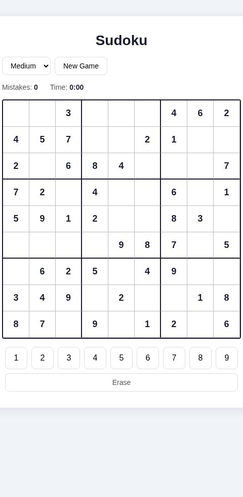

# Sudoku

A browser-based Sudoku game built with React. Puzzles are randomly generated in the browser.



## Features

- Random puzzle generation: a complete, valid grid is filled with a randomized backtracking algorithm, then cells are removed to create the puzzle
- Three difficulty levels, set by the number of starting clues: Easy (54), Medium (46), Hard (36)
- Click a cell and use the on-screen numpad to place a number
- Mistake counter with wrong entries highlighted in red
- Given cells are locked and cannot be edited
- Erase button to clear your own entries
- Elapsed time counter, reset on each new game
- Win detection when the board matches the solution
- Board highlighting for the selected cell, its row, column and 3x3 box, and matching numbers

## Tech stack

- React 19 (JavaScript/JSX)
- Vite 8
- No backend: game state lives in a custom `useSudokuBoard` hook and is shared with components through React Context

## Getting started

Requires Node.js 20.19+ or 22.12+.

```bash
git clone https://github.com/bchakanyuka/sudoku-app.git
cd sudoku-app
npm install
npm run dev
```

Then open the local URL Vite prints (usually http://localhost:5173).

## Scripts

| Command | What it does |
| --- | --- |
| `npm run dev` | Start the Vite dev server |
| `npm run build` | Build for production into `dist/` |
| `npm run preview` | Serve the production build locally |
| `npm run lint` | Run ESLint |

## Project structure

```
src/
  components/    Board, Cell, Numpad, GameControls, Game, StatusBar
  hooks/         useSudokuBoard.js (puzzle generation and game state)
  context/       GameContext.js (shares game state with components)
```
